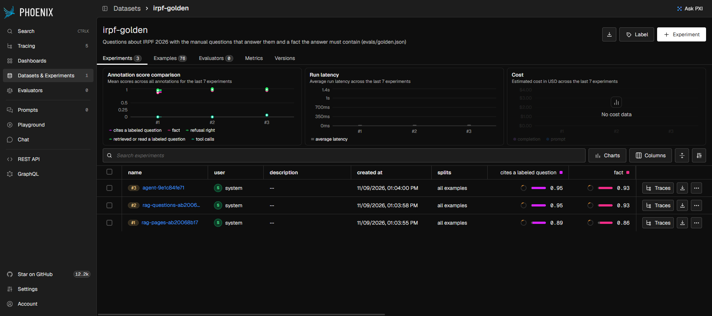

# IRPF Copilot

[](https://github.com/Eric-Souza/irpf-copilot/actions/workflows/ci.yml)

Ask a question about the Brazilian income tax return (IRPF 2026) in Portuguese, and get an answer from the Receita Federal's own **Perguntas e Respostas** manual, citing the manual's question numbers. An agent built on LlamaIndex Workflows follows the manual's "Consulte a pergunta ..." cross-references when one answer isn't enough, and says so when the manual doesn't cover the question. A golden set of 76 questions measures what the agent adds over plain RAG and what it costs.

It is part of a small personal-finance set, next to [Doc Extraction Copilot](https://github.com/Eric-Souza/doc-extraction-copilot), which reads an informe de rendimentos; this one explains what to do with it in the declaração.

```
$ uv run python -m irpf.agent "Meu filho e a esposa dele não têm renda e eu sustento os dois. Posso colocá-los como dependentes? E o filho deles, em que casos pode?"

O cônjuge ou convivente do filho também pode ser dependente na mesma declaração, desde que não
esteja declarando em separado [353]. Sobre os netos, eles podem ser dependentes: com idade de até
21 anos, desde que o contribuinte detenha a guarda judicial [354]; ...

(abridged) tools: read_question(354), cited: 353, 354, 2 model calls, 4,458 tokens, 2.3 s
```

Question 354 wasn't in the top 5 the search returned. Question 353 points to it, so the agent read it. The plain RAG baseline answers the same question without the guardianship condition.

## What it shows

- **A parsed corpus with its structure:** the 340-page PDF parsed into 745 numbered questions with their chapters, topics and the questions each one points to (`irpf/manual.py`). One question is one retrieval unit, and long answers are split under their question, so every chunk knows what to cite
- **An agent with two tools:** a LlamaIndex Workflow that starts from the same top 5 as the baseline and may call `search_manual(query)` or `read_question(number)`, up to 4 calls, before it answers
- **Citations checked by code:** every `[NNN]` the answer cites must have been retrieved or read in that conversation, or it's dropped from the text and reported
- **Refusals by the model, not by a threshold:** out-of-scope questions score almost as high in retrieval as answerable ones (median top similarity 0.853 against 0.888), so a similarity cutoff can't decide them
- **A golden set checked against the manual:** each fact an answer must contain is checked by a test against the labeled question's text, so a label can't drift from the manual
- **Chroma and Pinecone behind one retriever,** with the same embeddings, compared on the same queries
- **Traces and experiments in Phoenix:** each question is one trace, and each system's eval run is an experiment on the golden set

## Eval

`python -m evals.run` asks each golden question to three systems and scores the answers in code: whether the answer states the fact, cites a labeled question, and refuses only when it should. Answers are cached per system and per prompt version, so rescoring costs no quota. Results on the 76 questions (`evals/results/run.md`):

| System | Fact right | Multi-hop | Hard-hop | Refuses out of scope | Refuses in scope | Model calls | Tool calls | Tokens |
|---|---|---|---|---|---|---|---|---|
| RAG over page chunks | 86% | 83% | 57% (4/7) | 100% | 5% | 1.00 | 0.00 | 2,642 |
| RAG over questions | 94% | 92% | 57% (4/7) | 100% | 0% | 1.00 | 0.00 | 1,823 |
| Agent over questions | 94% | 92% | 71% (5/7) | 100% | 0% | 1.07 | 0.07 | 2,359 |

What it says:

- **The index matters more than the agent.** Question-level nodes beat fixed-size page chunks on every row, with a third less context per question.
- **Most multi-hop questions don't need the agent.** Retrieval already brings the second question of 11 of the 12 multi-hop pairs. The agent made one tool call across those 69 questions.
- **The hard-hop subset is where the agent helps.** These are 7 multi-hop pairs where the second question is outside the top 5, picked by running retrieval. The agent called a tool on 4 of them and got one more right than RAG, at about 30% more tokens on average. Seven items say where the agent helps, not by how much.
- **Some misses are wording.** A fact counts when the answer contains it verbatim. Some answers paraphrase it correctly ("declarando em conjunto com você" for the manual's "com o genro ou a nora") and are counted wrong; `evals/results/run.md` lists every wrong answer with its text.

Retrieval alone (`python -m evals.retrieval`, top 5 on the 65 answerable questions):

| Index | hit@1 | hit@5 | MRR@10 | Multi-hop, both @5 | Hard-hop, second @5 | Context at 5 |
|---|---|---|---|---|---|---|
| questions | 75% | 97% | 0.83 | 92% | 0% | 4,699 chars |
| pages | 55% | 94% | 0.70 | 75% | 43% | 7,058 chars |

On Pinecone (`--pinecone`) the scores are identical. 66 of 69 top-5 lists are the same, and the rest differ by a near tie. Pinecone's median query takes 151 ms from here, against 2 ms for Chroma on disk; both are well under the second a model call takes.

## Tracing with Phoenix

With `PHOENIX_COLLECTOR_ENDPOINT` set (`http://localhost:6006` for a local `phoenix serve`), [OpenInference](https://github.com/Arize-ai/openinference)'s LlamaIndex instrumentation sends each question to [Phoenix](https://github.com/Arize-ai/phoenix) as one trace (`irpf/tracing.py`). A trace holds the Workflow's steps, the retrievals, the model calls with their prompts, tool calls and tokens, and a span per tool call with the retrieval it made nested under it. Eval questions are tagged with the system, the golden id and the kind.

`python -m evals.phoenix` uploads the golden set as a dataset and logs each system's cached answers as an experiment, scored by the same code as the eval: fact, refusal, citations and tool calls. You can compare the three systems question by question without a model call.



## Stack

| Part | Choice |
|---|---|
| Corpus | Perguntas e Respostas IRPF 2026 v1.00 (23/04/2026), parsed with pypdf |
| Framework | LlamaIndex 0.14: `VectorStoreIndex`, Workflows, `FunctionTool` |
| Model | Gemini 3.5 Flash Lite (free tier), temperature 0 |
| Embeddings | `intfloat/multilingual-e5-base`, locally on CPU, cached on disk. `gemini-embedding-001` can be selected for comparison, but the free tier's 1000 embedding requests a day don't cover the 1,925 nodes |
| Vector stores | Chroma on disk; Pinecone serverless (free Starter plan) |
| Tracing | OpenTelemetry, OpenInference, Arize Phoenix (local) |
| Tooling | uv, Python 3.12, pytest, GitHub Actions |

Everything runs on free tiers.

## Project structure

```
irpf/
  manual.py      # PDF -> data/questions.jsonl: 745 questions, chapters, topics, cross-references
  index.py       # question and page nodes, embedding cache, Chroma and Pinecone, Search
  answer.py      # the model, the instructions, the citation check, refusals
  rag.py         # baseline: top 5, one model call
  agent.py       # the Workflow: start -> think -> act -> think ... -> answer
  golden.py      # golden set items and how a fact is matched
  tracing.py     # OpenTelemetry to Phoenix
evals/
  golden.json    # 76 questions: number, direct, colloquial, multi-hop, hard-hop, out of scope
  retrieval.py   # hit@k, MRR, multi-hop coverage, per index and store
  run.py         # every golden question through each system, scored, cached
  phoenix.py     # cached runs as Phoenix experiments
  results/       # the reports in this README
tests/           # parser, golden set, citation check, RAG and agent with a scripted model
```

## Getting started

```bash
uv sync
echo "GOOGLE_API_KEY=..." > .env              # a free key from Google AI Studio
uv run python -m irpf.index                   # embeds the manual locally and builds Chroma (a few minutes on CPU)
uv run python -m irpf.agent "posso declarar minha mãe como dependente?"
uv run python -m irpf.rag "..." [--pages]      # the baseline
```

The eval and tracing:

```bash
uv run python -m evals.retrieval              # no model calls
uv run python -m evals.run                    # 76 questions x 3 systems, cached in storage/answers
uvx --from arize-phoenix phoenix serve        # in another terminal
PHOENIX_COLLECTOR_ENDPOINT=http://localhost:6006 uv run python -m irpf.agent "..."
uv run python -m evals.phoenix                # cached answers as experiments
```

Pinecone: add `PINECONE_API_KEY` to `.env`, then `uv run python -m irpf.index --pinecone` and `uv run python -m evals.retrieval --pinecone`.

Tests need no key, index or model: `uv run pytest`.

| Variable | Default | |
|---|---|---|
| `GOOGLE_API_KEY` | none | Gemini, for answers |
| `PINECONE_API_KEY` | none | Only for the Pinecone store |
| `IRPF_EMBED_MODEL` | `intfloat/multilingual-e5-base` | Or `gemini-embedding-001` |
| `PHOENIX_COLLECTOR_ENDPOINT` | none | A Phoenix to send traces to |

## Not tax advice

The answers come from the manual and cite it, but the manual is general guidance and the model can still misread it. Check the cited questions before acting on an answer.
